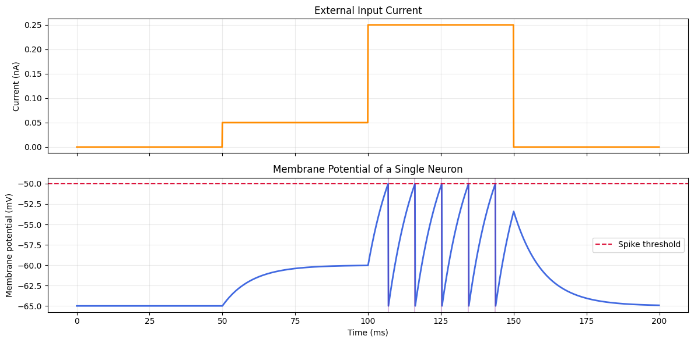
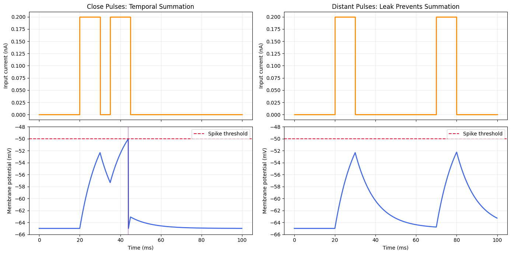
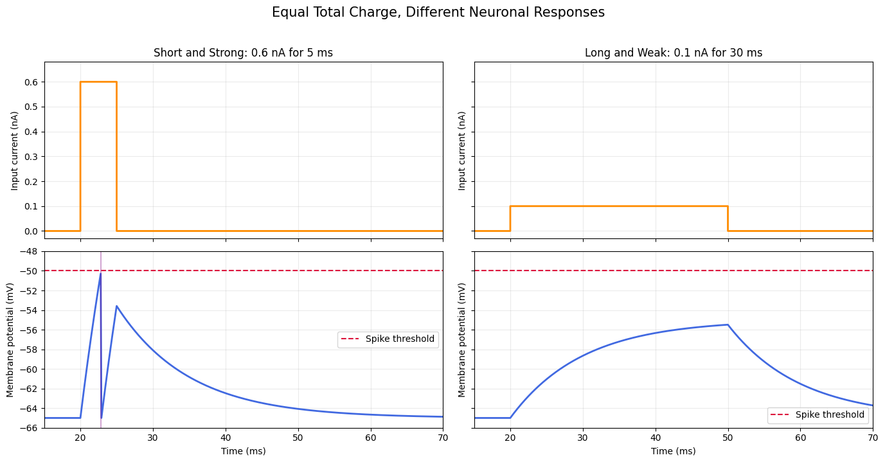
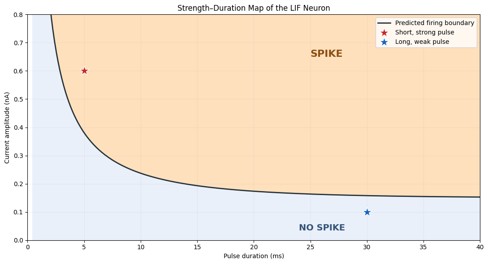
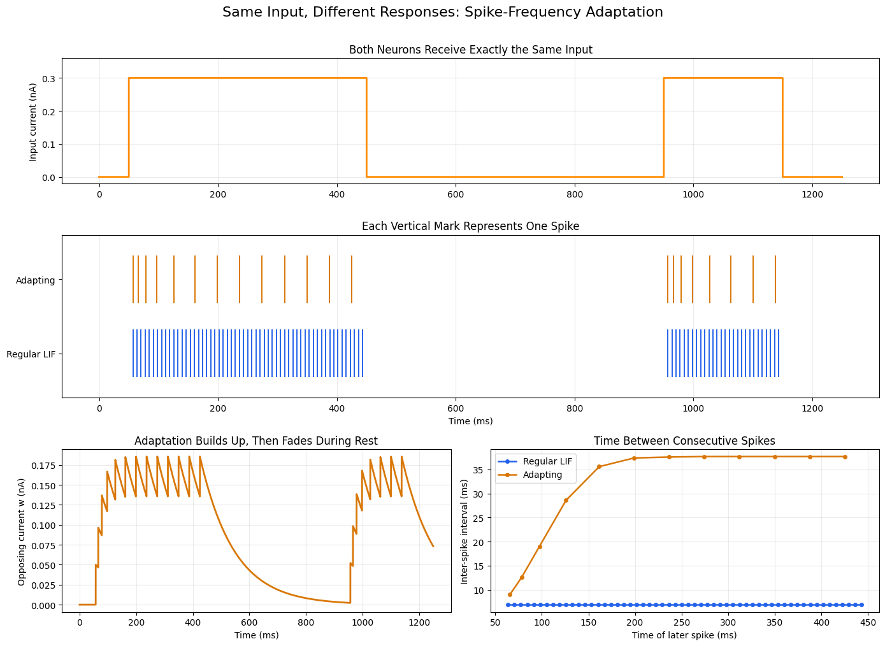
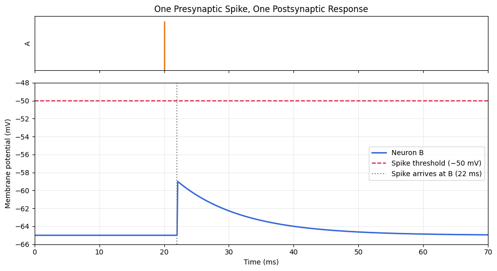

# NeuronLab

**A personal, experiment-driven journey into how neurons work.**

NeuronLab is my personal project for understanding the structure and function of neurons more deeply. I am starting with the electrical behavior of a single membrane, then moving toward synapses and small circuits. The goal is not just to run simulations: it is to ask a precise question, make a prediction, change one thing at a time, and understand *why* the result changes.

I use [Brian2](https://briansimulator.org/) and short, visual Jupyter notebooks to make each idea testable. These first labs focus on neuronal dynamics rather than detailed cell anatomy or full biological realism.

## How I am learning

Each lab follows the same experimental loop:

1. **Start with a biological question.** What behavior are we trying to understand?
2. **Build the smallest useful model.** Identify its assumptions and what it leaves out.
3. **Predict before running.** What should happen if the model is right?
4. **Change one variable.** Compare controlled conditions, not unrelated simulations.
5. **Read the evidence.** Inspect input, membrane voltage, spike times, and intermediate variables.
6. **Return to biology.** Ask what the model explains—and what would require a more realistic model or experimental data.

## Notebooks

| Lab | Question | What's inside | Status |
| --- | --- | --- | --- |
| [01 — From Input Current to Action Potentials](neuron_lab_01_input_current_to_action_potentials.ipynb) | How does input current lead to a spike? | Leaky integrate-and-fire (LIF), temporal summation, equal-charge pulses, strength–duration, and spike-frequency adaptation | Available |
| [02 — From Spikes to Synapses](Neuron_Lab_02_From_Spikes_to_Synapses.ipynb) | If one neuron fires, must another neuron fire too? | A controlled presynaptic spike, a delayed excitatory synapse, and a postsynaptic LIF response | In progress: first experiment available |

The planned next steps for Lab 02 are multiple timed inputs and inhibition. They are **not** implemented in the current notebook yet.

## A few results

### 1. Input changes voltage; crossing threshold produces spikes

The same simulated neuron stays near rest with no input, rises without firing under a weak current, and emits repeated threshold events under a stronger current.

### 2. Timing matters, even when the pulses are identical

Two close pulses combine before the first response leaks away. Moving the second pulse later prevents the spike, despite leaving pulse amplitude and count unchanged.

### 3. Equal total charge can produce different outcomes

A short, strong pulse produces a spike while a longer, weaker pulse with the same total charge does not. The strength–duration map extends this question across many amplitudes and durations:

### 4. The same input can produce a changing response

The regular LIF neuron keeps a nearly steady rhythm. In the adapting variant, a slow opposing variable builds up after spikes, spreads them farther apart, and decays during rest. This is a **model of a possible mechanism**, not a measurement of a particular ion channel.

### 5. Receiving a spike is not the same as firing one

In Lab 02's first experiment, a prescribed spike at 20 ms reaches the receiving neuron after a 2 ms delay. Its simplified synaptic effect raises the receiver's voltage but does not reach threshold: one spike is sent, zero are produced by the receiver.

*All figures above were exported from the saved outputs of the notebooks in this repository.*

## Run the labs

The easiest route is Google Colab:

1. Open [Lab 01 in Colab](https://colab.research.google.com/github/azibom/NeuronLab/blob/main/neuron_lab_01_input_current_to_action_potentials.ipynb) or [Lab 02 in Colab](https://colab.research.google.com/github/azibom/NeuronLab/blob/main/Neuron_Lab_02_From_Spikes_to_Synapses.ipynb).
2. Run the cells from top to bottom. Each notebook installs Brian2 in its own setup cell.
3. Make the written prediction before viewing each experiment's result, then try changing a single parameter.

For a local Jupyter environment, use Python 3 and install `brian2`, `numpy`, `matplotlib`, and `jupyterlab`, then open either notebook. An internet connection is needed for the notebook's package-installation cell in a fresh environment; if the dependencies are already installed locally, you can skip that cell.

## What these models do not claim

- LIF represents spike initiation with a threshold and reset; it does not reproduce the sodium and potassium currents that shape a biological action potential.
- The adaptation variable in Lab 01 summarizes slow opposing effects. It is not proof of a unique biological mechanism or an explanation of perception by itself.
- Lab 02 currently prescribes the sender's spike. Its first synapse is an instantaneous voltage jump, not a detailed model of neurotransmitter release, receptors, or synaptic conductance.
- These notebooks are educational experiments, not validated models of a particular person, disease, or clinical intervention.

The project is intentionally incremental: when a simple model cannot explain a behavior, the next step is to state that limitation clearly, add a justified mechanism, and test what new predictions it makes.

## References

- [Brian2 documentation](https://brian2.readthedocs.io/)
- [Neuronal Dynamics — the leaky integrate-and-fire model](https://neuronaldynamics.epfl.ch/online/Ch1.S3.html)
- [Neuronal Dynamics — adaptation and firing patterns](https://neuronaldynamics.epfl.ch/online/Ch6.html)
- [Neuroscience (NCBI Bookshelf) — chemical synapses](https://www.ncbi.nlm.nih.gov/books/NBK11009/)
